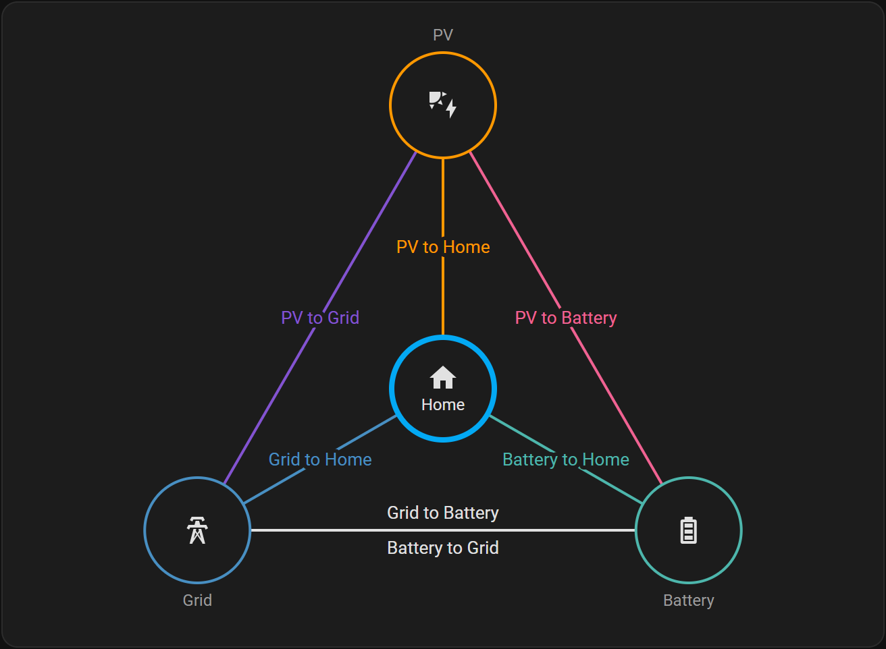
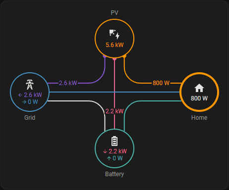
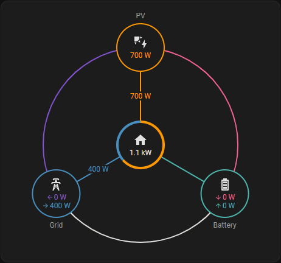
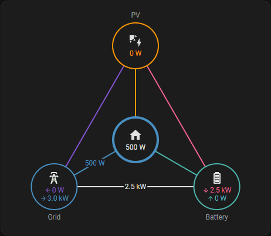

# ⚡ powerHELPER
**a little Home Assistant integration for power flows**

[](https://hacs.xyz)
[](https://github.com/Dennis90BW/ha-power-helper/releases)
[](https://github.com/Dennis90BW/ha-power-helper?tab=MIT-1-ov-file)
[](https://analytics.home-assistant.io/)
[](https://github.com/Dennis90BW/ha-power-helper)

🇩🇪 [Deutsch](README_de.md) | 🇺🇸 [English](README.md)

**powerHELPER** is a custom integration for **Home Assistant** that automatically breaks down electrical power flows between the **PV system, grid, battery, and home**.

Ideal for users of [Solar Forecast ML](https://github.com/Zara-Toorox/ha-solar-forecast-ml) and SFML-Stats. Thanks @Zara-Toorox for these awesome integrations!

---

## ⚠️ Disclaimer
This is my first GitHub project, and the custom integration was created with the help of AI. Despite careful implementation, **errors or inaccuracies may occur**. Feedback, [issues](https://github.com/Dennis90BW/ha-power-helper/issues), and improvement suggestions are always welcome!

---

## ✨ Features

- 🧩 Automatically creates missing **combined or separate power sensors** for **grid** and **battery**
- 🔌 Power flow breakdown (PV, grid, battery, home)
- 🔋 Battery power can be inverted
- ➕ Multiple PV systems and batteries can be added
- 🗺️ Dashboard card for the power flows in three layouts
- ⚙️ Easy setup and editing via the UI
- 📊 Output in **watts (W)**
- 🔄 Supports sensors in **W** and **kW**
- 🌍 Multilingual (DE / EN)

---

## 📦 Requirements

- Home Assistant **2025.12.x or newer**
- Existing power sensors with `device_class: power`:
  - Required: grid power **or** grid consumption & feed-in
  - Optional: PV power
  - Optional: battery power **or** battery charge & discharge

---

## 🚀 Installation

### 🔹 Marketplace (recommended)

1. Open the **Marketplace** (before HA 2026.11: **HACS**)
2. Search for **powerHELPER**
3. Click **Download**
4. Restart Home Assistant

---

### 🔹 Manual Installation

1. Download the repository
2. Copy the `power_helper` folder to: `config/custom_components/`
3. Restart Home Assistant

---

## ⚙️ Configuration

1. **Settings → Devices & Services**
2. **Add Integration**
3. Select **powerHELPER**
4. Set device name
5. Select your power sensors

---

## 🧠 Created Sensors and Devices

powerHELPER creates a **main device** and below it **one device per PV system and per battery**.
Add further PV systems and batteries on the integration page via **Add PV system** or **Add battery**; edit and delete them via the menu of each system.

Entity IDs are built from the device name and the sensor name (e.g. `<device>` = `powerhelper`).

### ⚖️ Power flows and balance

powerHELPER balances the power of PV, grid, battery and home and splits it into the possible power flows. There is a separate sensor for every flow in the picture; between grid and battery both directions are possible.

<p align="center"></p>

**Balance:** Home Power = PV Power + Grid Consumption − Grid Feed-in + Battery Discharging − Battery Charging

**Distribution:** PV supplies the home first, then charges the batteries and feeds the rest into the grid. Batteries with priority (e.g. DC-coupled) get PV power even before the home. Whatever PV and battery cannot cover comes from the grid.

### 🏠 Main device powerHELPER

#### 🔌 Grid
| Entity | Name |
|---|---|
| `sensor.<device>_grid_power` | Grid Power |
| `sensor.<device>_grid_consumption` | Grid Consumption |
| `sensor.<device>_grid_feed_in` | Grid Feed-in |

#### ☀️ PV – total of all PV systems
| Entity | Name |
|---|---|
| `sensor.<device>_pv_power` | PV Power |

#### 🔋 Battery – total of all batteries
Multiple batteries are netted against each other first: if one battery charges while another discharges, that power only flows between the batteries.

| Entity | Name |
|---|---|
| `sensor.<device>_battery_power` | Battery Power *positive = discharging* |
| `sensor.<device>_battery_power_inverted` | Battery Power (Inverted) *positive = charging* |
| `sensor.<device>_battery_charging` | Battery Charging |
| `sensor.<device>_battery_discharging` | Battery Discharging |

#### 🔀 Power flows
| Entity | Name |
|---|---|
| `sensor.<device>_pv_to_home` | PV to Home |
| `sensor.<device>_pv_to_battery` | PV to Battery |
| `sensor.<device>_pv_to_grid` | PV to Grid |
| `sensor.<device>_grid_to_home` | Grid to Home |
| `sensor.<device>_grid_to_battery` | Grid to Battery |
| `sensor.<device>_battery_to_home` | Battery to Home |
| `sensor.<device>_battery_to_grid` | Battery to Grid |

#### 🏠 Home
| Entity | Name |
|---|---|
| `sensor.<device>_home_power` | Home Power |

### ☀️ Connected device per PV system
| Entity | Name |
|---|---|
| `sensor.<pv-system>_power` | Power |

### 🔋 Connected device per battery
| Entity | Name |
|---|---|
| `sensor.<battery>_power` | Power *positive = discharging* |
| `sensor.<battery>_power_inverted` | Power (Inverted) *positive = charging* |
| `sensor.<battery>_charging` | Charging |
| `sensor.<battery>_discharging` | Discharging |

All sensors provide **watts (W)** and are fully dashboard-ready.

---

## 🗺️ Dashboard card "powerHELPER Power Flow"

powerHELPER ships its own card, styled after the energy dashboard. It shows the current power of PV, grid, battery and home and **the power of each flow right next to its line**.

| Classic | Round | Triangle |
|:---:|:---:|:---:|
|  |  |  |

**Add it:** Edit dashboard → **Add card** → **powerHELPER Power Flow** → select the device.

| Option | Description |
|---|---|
| Device | powerHELPER main device |
| Title | heading, prefilled with the device name when adding the card |
| Layout | **Classic**, **Round** or **Triangle** |
| Show 0 W on lines | also shows "0 W" on lines without power flow (default: off) |
| Show 0 W in circles | also shows rows with 0 W in the grid and battery circles (default: on) |
| Link to the energy dashboard | "Go to the energy dashboard" link in the footer (default: on) |
| Link to powerHELPER | "Go to powerHELPER" link to the integration page (default: off) |

```yaml
type: custom:power-helper-card
device_id: <id of the powerHELPER device>
layout: classic # classic | round | triangle
show_zero_flows: false
show_zero_node_values: true
link_energy_dashboard: true
link_power_helper: false
```

Clicking a circle opens the related sensor.

---

## ❓ FAQ

### Do I need AC or DC sensors?

In general, all sensors for this balance should be AC power sensors, as they represent the actual power flows in the electrical circuit.

DC sensors, such as those coming directly from inverters in the PV system or certain battery storage systems, can also be used. In this case, the DC/AC conversion losses are simply reflected in the **Home Power**, causing the overall consumption of the home to increase, similar to other electrical consumers.

---

## 🧪 Status

Version: **2.1.0**

Tested with PV + battery systems

---

## 📄 License

MIT License

Copyright (c) 2026 Dennis

---
