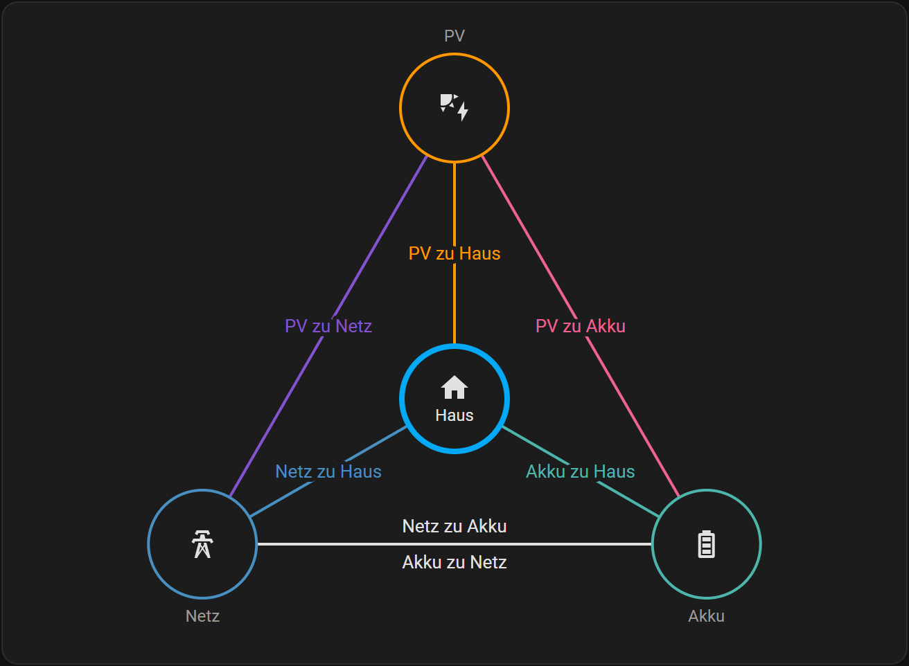
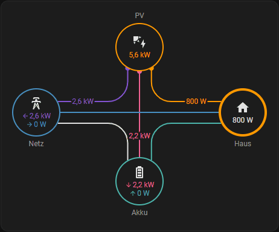
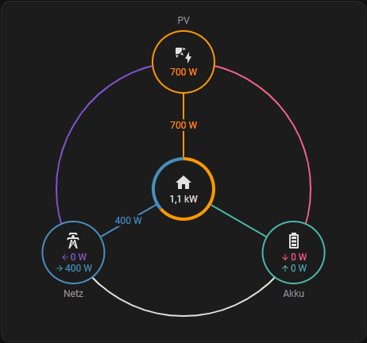
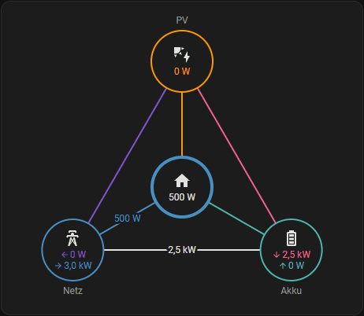

# ⚡ powerHELPER
**a little Home Assistant integration for power flows**

[](https://hacs.xyz)
[](https://github.com/Dennis90BW/ha-power-helper/releases)
[](https://github.com/Dennis90BW/ha-power-helper?tab=MIT-1-ov-file)
[](https://analytics.home-assistant.io/)
[](https://github.com/Dennis90BW/ha-power-helper)

🇩🇪 [Deutsch](README_de.md) | 🇺🇸 [English](README.md)

**powerHELPER** ist eine Custom Integration für **Home Assistant**, mit der elektrische Leistungsflüsse zwischen **PV-Anlage, Netz, Akku und Haus** automatisch aufgeschlüsselt werden.

Ideal für Nutzer von [Solar Forecast ML](https://github.com/Zara-Toorox/ha-solar-forecast-ml) und SFML-Stats. Danke @Zara-Toorox für diese tollen Integrationen!

---

## ⚠️ Disclaimer
Dies ist mein erstes GitHub-Projekt und die Custom Integration wurde mithilfe von KI erstellt. Trotz sorgfältiger Umsetzung **können Fehler oder Ungenauigkeiten auftreten**. Feedback, [Issues](https://github.com/Dennis90BW/ha-power-helper/issues) und Verbesserungsvorschläge sind jederzeit willkommen!

---

## ✨ Features

- 🧩 Erstellt automatisch fehlende **kombinierte oder getrennte Leistungssensoren** für **Netz-** und **Akkuleistung**
- 🔌 Aufteilung von Leistungsflüssen (PV, Netz, Akku, Haus)
- 🔋 Akku-Leistung kann invertiert werden
- ➕ Mehrere PV-Anlagen und Akkus können hinzugefügt werden
- 🗺️ Dashboard-Karte für die Leistungsflüsse in drei Darstellungen
- ⚙️ Einfache Einrichtung und Bearbeitung über die UI
- 📊 Ausgabe in **Watt (W)**
- 🔄 Unterstützt Sensoren in **W** und **kW**
- 🌍 Mehrsprachig (DE / EN)

---

## 📦 Voraussetzungen

- Home Assistant **2025.12.x oder neuer**
- Vorhandene Leistungssensoren mit device_class "power":
  - Pflicht: Netz Leistung **oder** Netzbezug & Einspeisung
  - Optional: PV-Leistung
  - Optional: Akku Leistung **oder** Akku Laden & Entladen

---

## 🚀 Installation

### 🔹 Marketplace (empfohlen)

1. Öffne den **Marketplace** (vor HA 2026.11: **HACS**)
2. Suche nach **powerHELPER**
3. auf **Herunterladen** klicken
4. Home Assistant neu starten

---

### 🔹 Manuelle Installation

1. Repository herunterladen
2. Ordner `power_helper` kopieren nach: `config/custom_components/`
3. Home Assistant neu starten

---

## ⚙️ Konfiguration

1. **Einstellungen → Geräte & Dienste**
2. **Integration hinzufügen**
3. **powerHELPER** auswählen
4. Gerätenamen festlegen
5. Leistungssensoren auswählen

---

## 🧠 Erzeugte Sensoren und Geräte

powerHELPER legt ein **Hauptgerät** an und darunter **je PV-Anlage und je Akku ein eigenes Gerät**.
Weitere PV-Anlagen und Akkus fügst du auf der Integrationsseite über **PV-Anlage hinzufügen** bzw. **Akku hinzufügen** hinzu; bearbeiten und löschen geht über das Menü der jeweiligen Anlage.

Die Entity-IDs entstehen aus Gerätename und Sensorname (z. B. `<gerät>` = `powerhelper`).

### ⚖️ Leistungsflüsse und Bilanz

powerHELPER bilanziert die Leistungen von PV, Netz, Akku und Haus und teilt sie auf die möglichen Leistungsflüsse auf. Für jeden Fluss im Bild gibt es einen eigenen Sensor; zwischen Netz und Akku sind beide Richtungen möglich.

<p align="center"></p>

**Bilanz:** Haus Leistung = PV Leistung + Netzbezug − Netzeinspeisung + Akku entladen − Akku laden

**Aufteilung:** PV versorgt zuerst das Haus, lädt danach die Akkus und speist den Rest ins Netz ein. Akkus mit Priorität (z. B. DC-gekoppelt) bekommen PV-Leistung schon vor dem Haus. Was PV und Akku nicht decken, kommt aus dem Netz.

### 🏠 Hauptgerät powerHELPER

#### 🔌 Netz
| Entität | Name |
|---|---|
| `sensor.<gerät>_netz_leistung` | Netz Leistung |
| `sensor.<gerät>_netzbezug` | Netzbezug |
| `sensor.<gerät>_netzeinspeisung` | Netzeinspeisung |

#### ☀️ PV – Summe aller PV-Anlagen
| Entität | Name |
|---|---|
| `sensor.<gerät>_pv_leistung` | PV Leistung |

#### 🔋 Akku – Summe aller Akkus
Mehrere Akkus werden zuerst miteinander verrechnet: Lädt ein Akku, während ein anderer entlädt, fließt diese Leistung nur zwischen den Akkus.

| Entität | Name |
|---|---|
| `sensor.<gerät>_akku_leistung` | Akku Leistung *positiv = Entladen* |
| `sensor.<gerät>_akku_leistung_invertiert` | Akku Leistung (invertiert) *positiv = Laden* |
| `sensor.<gerät>_akku_laden` | Akku laden |
| `sensor.<gerät>_akku_entladen` | Akku entladen |

#### 🔀 Leistungsflüsse
| Entität | Name |
|---|---|
| `sensor.<gerät>_pv_zu_haus` | PV zu Haus |
| `sensor.<gerät>_pv_zu_akku` | PV zu Akku |
| `sensor.<gerät>_pv_zu_netz` | PV zu Netz |
| `sensor.<gerät>_netz_zu_haus` | Netz zu Haus |
| `sensor.<gerät>_netz_zu_akku` | Netz zu Akku |
| `sensor.<gerät>_akku_zu_haus` | Akku zu Haus |
| `sensor.<gerät>_akku_zu_netz` | Akku zu Netz |

#### 🏠 Haus
| Entität | Name |
|---|---|
| `sensor.<gerät>_haus_leistung` | Haus Leistung |

### ☀️ Verbundenes Gerät je PV-Anlage
| Entität | Name |
|---|---|
| `sensor.<pv-anlage>_leistung` | Leistung |

### 🔋 Verbundenes Gerät je Akku
| Entität | Name |
|---|---|
| `sensor.<akku>_leistung` | Leistung *positiv = Entladen* |
| `sensor.<akku>_leistung_invertiert` | Leistung (invertiert) *positiv = Laden* |
| `sensor.<akku>_laden` | Laden |
| `sensor.<akku>_entladen` | Entladen |

Alle Sensoren liefern **Watt (W)** und sind Dashboard-fähig.

---

## 🗺️ Dashboard-Karte „powerHELPER Leistungsfluss“

powerHELPER bringt eine eigene Karte mit, die sich am Energie-Dashboard orientiert. Sie zeigt die aktuellen Leistungen von PV, Netz, Akku und Haus und **die Leistung jedes Flusses direkt an der Linie**.

| Klassisch | Rund | Dreieck |
|:---:|:---:|:---:|
|  |  |  |

**Hinzufügen:** Dashboard bearbeiten → **Karte hinzufügen** → **powerHELPER Leistungsfluss** → Gerät auswählen.

| Option | Beschreibung |
|---|---|
| Gerät | Hauptgerät von powerHELPER |
| Titel | Überschrift, beim Hinzufügen mit dem Gerätenamen vorausgefüllt |
| Darstellung | **Klassisch**, **Rund** oder **Dreieck** |
| 0 W an Linien anzeigen | zeigt „0 W“ auch an Linien ohne Leistungsfluss (Standard: aus) |
| 0 W in Kreisen anzeigen | zeigt bei Netz und Akku auch Zeilen mit 0 W (Standard: an) |
| Link zum Energie-Dashboard | Link „Energie-Dashboard aufrufen“ in der Fußzeile (Standard: an) |
| Link zum powerHELPER | Link „powerHELPER aufrufen“ zur Integrationsseite (Standard: aus) |

```yaml
type: custom:power-helper-card
device_id: <id des powerHELPER-Geräts>
layout: classic # classic | round | triangle
show_zero_flows: false
show_zero_node_values: true
link_energy_dashboard: true
link_power_helper: false
```

Ein Klick auf einen Kreis öffnet den zugehörigen Sensor.

---

## ❓ FAQ

### Benötige ich AC oder DC Sensoren?

Im Allgemeinen sollten alle Sensoren für diese Bilanz AC-Leistungen sein, da diese die tatsächlichen Leistungsflüsse im Stromkreis darstellen.

DC-Sensoren, wie sie beispielsweise von Wechselrichtern direkt aus der PV-Anlage oder bestimmten Akkuspeichern kommen, können ebenfalls genutzt werden. In diesem Fall spiegeln sich die DC/AC-Wandlungsverluste einfach in der **Haus Leistung** wider, wodurch der Gesamtverbrauch des Hauses entsprechend steigt, ähnlich wie bei anderen elektrischen Verbrauchern.

---

## 🧪 Status

Version: **2.1.0**

Getestet mit PV + Akku Systemen

---

## 📄 Lizenz

MIT License

Copyright (c) 2026 Dennis

---